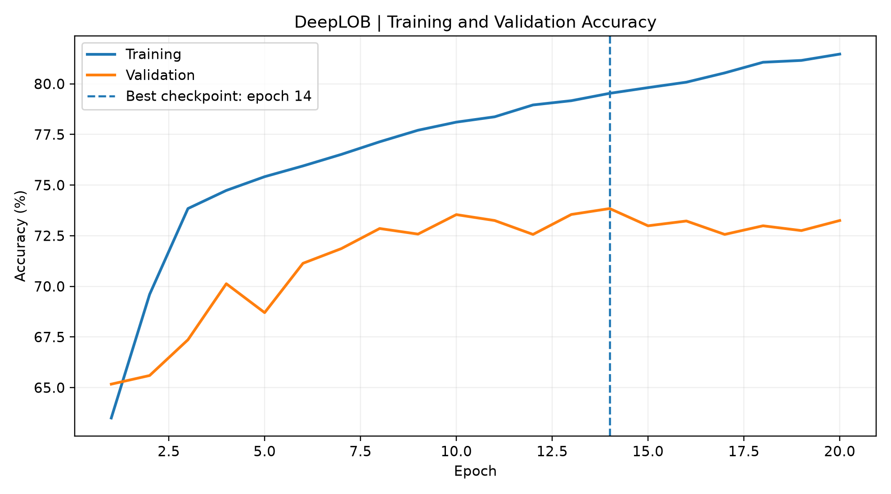
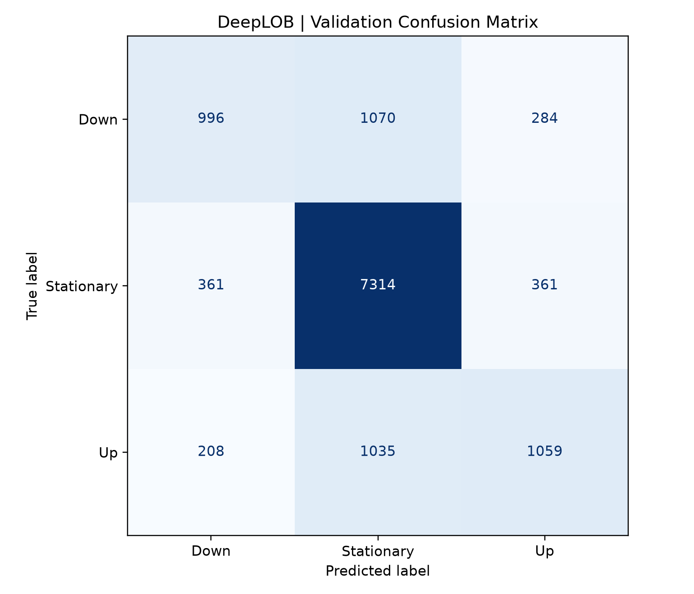
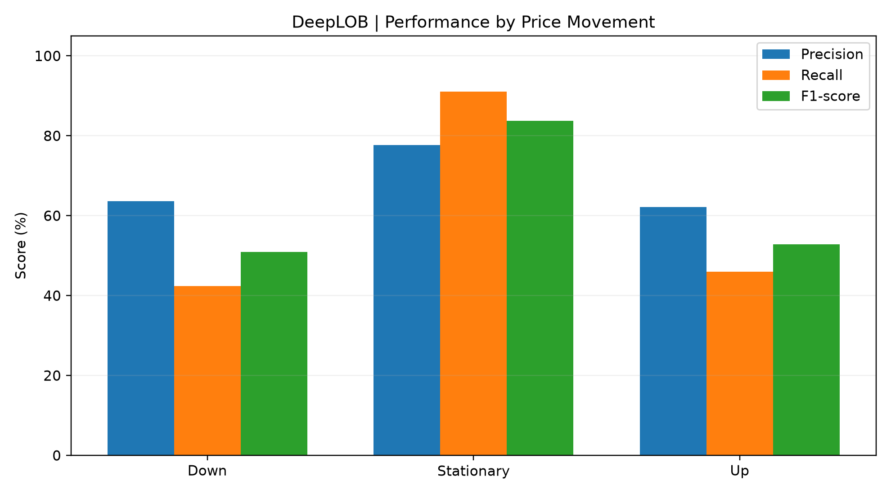

# DeepLOB: Quantitative Machine Learning Research

**Financial market microstructure prediction | FI-2010 | PyTorch | CNN-Inception-LSTM**

[](https://www.python.org/)
[](https://pytorch.org/)

## Overview

How much predictive information can a neural network extract from high-frequency **limit order book (LOB)** observations, and how robust are those predictions across different training and evaluation choices?

This repository documents my **CPU-based quantitative machine-learning experiments** on the FI-2010 benchmark, using a DeepLOB-based CNN-Inception-LSTM model to classify near-term mid-price movement as **Down**, **Stationary**, or **Up**. I focused on temporal data sampling, training optimisation, architecture comparisons, class imbalance, and rigorous model diagnostics.

My experiments focus on the relationship between training-data coverage, optimisation choices and class-level predictive performance. The repository includes the scripts, configurations and figures used to document these investigations.

## Results at a Glance

| Metric | Result | Evaluation context |
|:--|--:|:--|
| **Best exploratory test accuracy** | **70.08%** | FI-2010 sampled test data, k = 10 |
| **Best validation accuracy** | **73.84%** | Selected checkpoint, epoch 14 |
| Test-set majority-class baseline | 49.07% | Predict Stationary for every observation |
| Validation macro-F1 | ~63% | Class-balanced view of prediction quality |
| Validation directional recall | Down ~42%, Up ~46% | Reveals majority-class bias |
| Automated tests | 49 passed | Project test suite |
| Input tensor per example | 100 × 40 | 100 LOB observations, 40 features |
| Training environment | CPU-only | Approximately 12 GB of available RAM |

> **Interpretation:** The 70.08% figure is an **exploratory** result, not a clean final out-of-sample estimate: the test period was examined during development. It is not a measure of trading returns or profitability.

## Experimental Journey

| Experiment | Exploratory test accuracy | What changed |
|:--|--:|:--|
| Initial DeepLOB run | 29.73% | Single training epoch |
| Optimisation / longer training | 57.79% | Adjusted Adam settings and training duration |
| Broader temporal sampling | 68.31% | More diverse sampled training data |
| Increased sample coverage | **70.08%** | Denser sampling, best validation checkpoint |

These are **sequential development experiments, not controlled ablations**. They used different training durations and/or data samples, so the gains cannot be attributed to an individual change in isolation.

### What I added and investigated

- **Temporal preprocessing and sampling:** `scripts/prepare_diverse_laptop.py` and `scripts/prepare_stride4.py`, generating manageable FI-2010 training/validation/test tensors for local CPU experiments.
- **Configurable experiments:** laptop-tuned, temporally diverse, denser-sampling and CNN-Attention configurations under `configs/`.
- **Class-imbalance investigation:** `scripts/train_weighted_laptop.py` evaluates class-weighted cross-entropy and macro-F1 selection. Directional recall improved, while overall accuracy traded off against that gain.
- **Architecture comparison:** a CNN-Attention run collapsed to predicting the Stationary class on the test sample, illustrating why accuracy alone is insufficient.
- **Result visualisation:** `scripts/create_portfolio_figures.py` produces learning curves, a confusion matrix, and class-level precision/recall/F1 plots.

## Model and Data

**Dataset:** FI-2010, with limit order book prices and quantities represented as 40 input features. Each model example uses a rolling window of **100 LOB observations**. The experiments shown here use the **k = 10 event prediction horizon**.

**Architecture:** I developed and optimised a DeepLOB-based quantitative machine-learning system combining convolutional neural networks, Inception modules and long short-term memory (LSTM) networks. The convolutional layers extract structural patterns from high-frequency limit order book data, while the Inception modules capture multi-scale market features. The LSTM models temporal dependencies, enabling the system to classify short-term mid-price movements as Down, Stationary or Up.

**Experimental setup:** The best reported run used temporally sampled observations, a chronological training/validation separation with a gap, and validation-based checkpoint selection. Rolling windows can overlap within data splits; overlap handling and completely untouched future-period evaluation remain important future work.

## Training and Evaluation Visualisations

### Learning dynamics



The selected checkpoint achieved **73.84% validation accuracy at epoch 14**. Training accuracy subsequently exceeded 81%, suggesting a growing train–validation generalisation gap.

### Validation confusion matrix



The model was strongest on the Stationary class (approximately 91% recall), with weaker recall on Down (~42%) and Up (~46%).

### Per-class precision, recall and F1



Class-level measures and macro-F1 help reveal directional weaknesses that overall accuracy can obscure.

## Repository Guide

| Path | Purpose |
|:--|:--|
| `scripts/prepare_diverse_laptop.py` | Temporally diverse sampled dataset preparation |
| `scripts/prepare_stride4.py` | Denser sampled dataset preparation |
| `scripts/train_weighted_laptop.py` | Class-weighted training experiment |
| `scripts/create_portfolio_figures.py` | Research plots |
| `configs/deeplob_laptop_*.yaml` | Tuned, diverse and stride-4 training configurations |
| `configs/cnn_attention_laptop.yaml` | Attention comparison configuration |
| `experiments/laptop_stride4/figures/` | Figures shown in this README |
| `src/`, `tests/`, other `scripts/` | Model implementation, training utilities and automated tests |

Generated dataset tensors, downloaded FI-2010 source data, local environments and temporary pytest output are intentionally **not committed**.

## Reproducing the Experiments

The commands below are intended for **Windows PowerShell** from the repository root, with Python 3.12 installed. Training time and memory requirements vary by machine.

```powershell
# Clone the repository
git clone https://github.com/Filip-2002/DeepLOB-Quantitative-Machine-Learning-Research.git

# Enter the project folder
cd DeepLOB-Quantitative-Machine-Learning-Research

# Create a virtual environment
python -m venv .venv

# Install dependencies
.\.venv\Scripts\python.exe -m pip install -r requirements.txt

# Download the FI-2010 dataset
.\.venv\Scripts\python.exe scripts/download_data.py

# Prepare the training dataset
.\.venv\Scripts\python.exe scripts/prepare_stride4.py

# Train and evaluate the model
.\.venv\Scripts\python.exe scripts/train.py --config configs/deeplob_laptop_stride4.yaml --device cpu

# Run automated tests
.\.venv\Scripts\python.exe -m pytest tests/ -v
```

The experiment configuration and local processed data must agree. The prepared data files are not part of this repository, so you must generate them before running the corresponding training configuration. Reproducing a stochastic experiment may require matching random seeds, dependency versions and machine settings.

## Limitations and Research Roadmap

**What this work currently establishes:** promising short-horizon classification performance on a sampled FI-2010 setup, plus evidence about data coverage, majority-class behaviour, and optimisation trade-offs.

**What it does not yet establish:** a clean final unseen-period result, statistical significance across repeated seeds and market regimes, or profitable executable trading signals.

Next research steps:

1. **Evaluation integrity:** use a completely untouched chronological holdout, with appropriate purging/embargo for overlapping windows; separate model development from final testing.
2. **More complete experimentation:** train on the full benchmark where feasible, repeat multiple random seeds, quantify confidence intervals, and compare against strong baselines.
3. **Robust directional prediction:** explore calibration, confidence-aware abstention, balanced metrics, and more systematic class-imbalance treatments.
4. **Economic evaluation:** implement event-driven backtests with spreads, slippage, transaction costs, latency, liquidity constraints, turnover and risk-adjusted net performance.
5. **Generalisation:** investigate behaviour across new market periods, varying liquidity and distribution shifts.

More GPU compute could enable larger and more systematic experiments, but **does not guarantee higher accuracy**. Likewise, predictive accuracy does not by itself demonstrate economic advantage.
