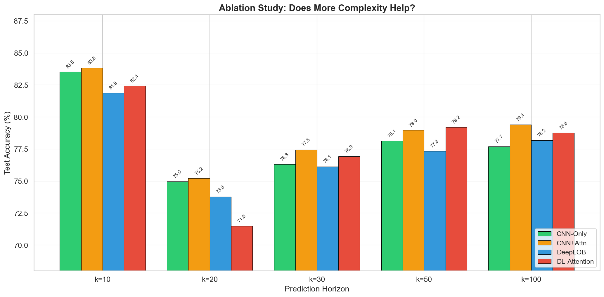
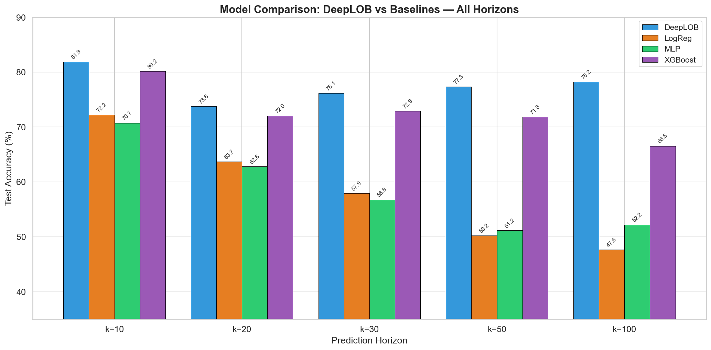

# DeepLOB: Reproducing and Extending Deep Learning for Limit Order Books

**A reproduction of the DeepLOB paper with a Transformer extension, an ablation study, and spread-cost backtesting on FI-2010.**

[](https://www.python.org/downloads/)
[](https://pytorch.org/)
[](LICENSE)

This project reimplements DeepLOB ([Zhang, Zohren & Roberts, 2019](https://arxiv.org/abs/1808.03668)), following the authors' official code, extends it with Transformer-based variants, runs an ablation study across 4 deep learning architectures, and tests six of the seven models (the four deep learning models plus logistic regression and XGBoost) in a backtesting pipeline that charges half the bid-ask spread per unit position change. It covers 95 machine-learning experiments (35 model and horizon runs plus 60 cost-aware training runs); the 80 deep learning runs were trained on the Rutgers Amarel HPC cluster with SLURM (GPUs including A100 and L40S).

It started as a Rutgers Quant Finance Club research project (February to May 2026) to reproduce DeepLOB, and was extended independently to compare simpler architectures, cost-aware training objectives, and trading-rule variants. The research report was submitted to the Rutgers Quant Finance Club.

**Main finding:** higher classification accuracy did not reliably mean better simulated trading results after spread costs. The best results came from layering post-training filters (ensemble agreement, cross-horizon consistency, volatility regime, and a holding period) on top of the model predictions.



---

## Key Results

### Model Comparison (test accuracy %, FI-2010 Setup 2)

| Model | Architecture | Trainable params | Avg accuracy (5 horizons) |
|-------|--------------|------------------|---------------------------|
| **CNN+Attention** | CNN + Transformer, no Inception | **67,139** | **78.98%** |
| CNN-Only | CNN + global average pooling | 37,891 | 78.13% |
| DL-Attention | CNN + Inception + Transformer | -- | 77.77% |
| DeepLOB (reproduced) | CNN + Inception + LSTM | 143,907 | 77.46% |
| XGBoost | Gradient-boosted trees | -- | 72.68% |
| MLP | Neural baseline | -- | 58.72% |
| LogReg | Logistic regression | -- | 58.32% |

Average accuracy is the mean test accuracy over the five prediction horizons (k = 10, 20, 30, 50 and 100 order-book events). The per-horizon results are in the chart above and in the notebooks.



### Backtest Results (spread costs included)

| Strategy | Net PnL (normalized price units) | Position changes |
|----------|---------------------------------|------------------|
| **Combined layered filters** (ensemble agreement, cross-horizon agreement, volatility regime, holding period) | **+0.71** | **461** |
| DeepLOB, trade on every prediction | -7.91 | 37,115 |

These are exploratory backtests on the FI-2010 test days with a simple cost model (half the bid-ask spread per unit position change). PnL is in decimal-precision-normalized price units, not dollars or returns, and filter settings were chosen on the same test period. Across models, higher accuracy did not reliably mean better simulated trading results.

---

## Key Findings

1. **A much smaller CNN was competitive with DeepLOB.** The CNN-Only model (37,891 parameters, about 3.8x smaller than the 143,907-parameter DeepLOB) reached 78.13% average accuracy versus 77.46% in these runs.

2. **Simplified attention scored highest.** CNN+Attention without the Inception module (67,139 parameters) reached the highest average accuracy, 78.98%, 1.52 percentage points above the DeepLOB reproduction.

3. **Trading on every prediction was dominated by spread costs.** DeepLOB trading on every prediction made 37,115 position changes on the test days and ended at -7.91 net PnL (normalized price units).

4. **Accuracy and trading results diverged.** Better classification accuracy did not consistently translate into better simulated trading results after spread costs in the tested setup.

5. **Cost-aware training was tested across 60 runs.** Four loss families (weighted cross-entropy, focal loss, turnover-penalized cross-entropy, and a differentiable Sharpe loss), three settings each, five horizons. In these runs, the best simulated result came from post-training filters rather than from a cost-aware loss, and some turnover and Sharpe-loss settings substantially lowered accuracy.

6. **Layered filters gave the best simulated result.** Combining ensemble agreement, cross-horizon agreement, a volatility regime filter and a holding period reached +0.71 with 461 position changes, compared with -7.91 and 37,115 position changes for DeepLOB trading on every prediction (exploratory; see the note under the backtest table).

---

## Project Structure

```
lob-deep-learning-trading/
Γö£ΓöÇΓöÇ src/
Γöé   Γö£ΓöÇΓöÇ models/
Γöé   Γöé   Γö£ΓöÇΓöÇ deeplob.py          # Original DeepLOB (CNN + Inception + LSTM)
Γöé   Γöé   ΓööΓöÇΓöÇ extension.py        # DL-Attention, CNN-Only, CNN+Attention
Γöé   Γö£ΓöÇΓöÇ losses/
Γöé   Γöé   ΓööΓöÇΓöÇ cost_aware.py       # Focal, Weighted CE, Turnover, Sharpe losses
Γöé   Γö£ΓöÇΓöÇ data/
Γöé   Γöé   ΓööΓöÇΓöÇ dataset.py          # FI-2010 Dataset and DataLoader
Γöé   Γö£ΓöÇΓöÇ training/
Γöé   Γöé   ΓööΓöÇΓöÇ trainer.py          # Training loop with early stopping
Γöé   ΓööΓöÇΓöÇ backtest.py             # Signal-to-trade, PnL, transaction costs
Γö£ΓöÇΓöÇ notebooks/
Γöé   Γö£ΓöÇΓöÇ 01_data_exploration.ipynb   # Dataset structure, distributions, LOB visualization
Γöé   Γö£ΓöÇΓöÇ 02_evaluation.ipynb         # DeepLOB reproduction results, confusion matrices
Γöé   Γö£ΓöÇΓöÇ 03_baselines.ipynb          # LogReg, MLP, XGBoost comparison
Γöé   Γö£ΓöÇΓöÇ 04_extension.ipynb          # Transformer extension + ablation study
Γöé   Γö£ΓöÇΓöÇ 05_backtest.ipynb           # Full backtesting analysis (19 sections)
Γöé   Γö£ΓöÇΓöÇ 06_cost_aware.ipynb         # Cost-aware training experiments (60 results)
Γöé   ΓööΓöÇΓöÇ 07_advanced_strategies.ipynb # Advanced post-hoc trading strategies
Γö£ΓöÇΓöÇ scripts/
Γöé   Γö£ΓöÇΓöÇ train.py                    # DeepLOB training
Γöé   Γö£ΓöÇΓöÇ train_extension.py          # Extension model training
Γöé   Γö£ΓöÇΓöÇ train_baselines.py          # Baseline model training
Γöé   Γö£ΓöÇΓöÇ train_cost_aware.py         # Cost-aware training (4 loss types)
Γöé   ΓööΓöÇΓöÇ generate_*.py              # Prediction and probability generation
Γö£ΓöÇΓöÇ configs/
Γöé   Γö£ΓöÇΓöÇ deeplob_fi2010.yaml         # DeepLOB hyperparameters
Γöé   Γö£ΓöÇΓöÇ extension_fi2010.yaml       # Transformer extension config
Γöé   Γö£ΓöÇΓöÇ ablation_*.yaml             # Ablation study configs
Γöé   ΓööΓöÇΓöÇ cost_aware/                 # 4 cost-aware loss configs
Γö£ΓöÇΓöÇ experiments/                    # Saved run configs and result charts
Γö£ΓöÇΓöÇ tests/                          # Unit tests (model, data, training)
Γö£ΓöÇΓöÇ docs/                           # Research report, experiment log, architecture decisions
ΓööΓöÇΓöÇ data/                           # FI-2010 dataset (not tracked in git)
```

---

## Quick Start

```bash
# Clone and set up environment
git clone https://github.com/chirath-st/lob-deep-learning-trading.git
cd lob-deep-learning-trading
python -m venv .venv && source .venv/bin/activate
pip install -r requirements.txt

# Download FI-2010 dataset
python scripts/download_data.py

# Train DeepLOB on horizon k=10
python scripts/train.py --config configs/deeplob_fi2010.yaml

# Train the Transformer extension and the two ablation models
python scripts/train_extension.py --config configs/extension_fi2010.yaml
python scripts/train_extension.py --config configs/ablation_cnn_only.yaml
python scripts/train_extension.py --config configs/ablation_cnn_attention.yaml

# Run tests
pytest tests/ -v
```

---

## Models

### DeepLOB (Baseline Reproduction)
CNN (3 conv blocks) -> Inception Module -> LSTM (64 units) -> FC.
143,907 parameters. Reproduced on all 5 horizons; accuracy is 2.6 to 6.3 percentage points below the paper's reported results.

### DL-Attention (Extension)
Replaces LSTM with 2-layer Transformer encoder (d=192, 4 heads, ff=256).
Average accuracy 77.77%, 0.31 percentage points above the DeepLOB reproduction.

### CNN-Only (Ablation)
CNN blocks only -> Global Average Pooling -> FC. No Inception, no temporal model.
37,891 parameters, about 3.8x smaller than DeepLOB. 78.13% average accuracy versus 77.46% for the DeepLOB reproduction, showing that a much smaller model was competitive in these runs.

### CNN+Attention (Ablation -- Best Classifier)
CNN blocks -> Transformer (d=32, 4 heads, 2 layers) -> FC. No Inception.
67,139 parameters. Highest average accuracy (78.98%), 1.52 percentage points above the DeepLOB reproduction in these runs.

---

## Experiments

**95 machine-learning experiments**; the 80 deep learning runs trained on Rutgers Amarel HPC with SLURM (GPUs including A100 and L40S):

| Category | Count | Description |
|----------|-------|-------------|
| DeepLOB reproduction | 5 | All 5 horizons (k=10, 20, 30, 50, 100) |
| Baselines | 15 | LogReg + MLP + XGBoost, all 5 horizons |
| DL-Attention | 5 | Transformer extension, all horizons |
| CNN-Only ablation | 5 | Minimal model, all horizons |
| CNN+Attention ablation | 5 | Best classifier, all horizons |
| Cost-aware training | 60 | 4 loss types x 3 params x 5 horizons |

All experiments use seed=42, FI-2010 Setup 2 (days 1-7 train, days 8-10 test), and early stopping with patience=20. DeepLOB uses the paper's learning rate (0.01); CNN-Only and CNN+Attention use 0.001.

---

## Notebooks

| Notebook | Description |
|----------|-------------|
| [01 -- Data Exploration](notebooks/01_data_exploration.ipynb) | FI-2010 dataset structure, LOB feature visualization, label distributions across horizons |
| [02 -- Evaluation](notebooks/02_evaluation.ipynb) | DeepLOB reproduction results, confusion matrices, per-class metrics, comparison to paper Table II |
| [03 -- Baselines](notebooks/03_baselines.ipynb) | LogReg, MLP, XGBoost comparison, accuracy bar charts, DeepLOB advantage analysis |
| [04 -- Extension](notebooks/04_extension.ipynb) | Transformer extension results, ablation study (CNN-Only, CNN+Attention), parameter efficiency analysis |
| [05 -- Backtest](notebooks/05_backtest.ipynb) | Full backtesting pipeline: naive trading, holding periods, confidence gating, temperature scaling, cross-horizon consensus, stacking meta-learner (19 sections) |
| [06 -- Cost-Aware Training](notebooks/06_cost_aware.ipynb) | 60 cost-aware experiments: Weighted CE, Focal Loss, Turnover Penalty, Differentiable Sharpe, multi-horizon robustness analysis |
| [07 -- Advanced Strategies](notebooks/07_advanced_strategies.ipynb) | Post-hoc trading strategies: ensemble disagreement, multi-horizon arbitrage, regime detection, Kelly sizing, meta-labeling, combined layered strategy |

---

## Research Report

The full write-up is in [docs/report_draft.md](docs/report_draft.md) ([PDF](docs/report_draft.pdf)). Project page: [chirath-st.github.io/projects/research-report](https://chirath-st.github.io/projects/research-report/).

---

## References

- **DeepLOB Paper:** Zhang, Z., Zohren, S., & Roberts, S. (2019). DeepLOB: Deep Convolutional Neural Networks for Limit Order Books. *IEEE Transactions on Signal Processing, 67*(11), 3001-3012. [arXiv:1808.03668](https://arxiv.org/abs/1808.03668)
- **FI-2010 Dataset:** Ntakaris, A., Magris, M., Kanniainen, J., Gabbouj, M., & Iosifidis, A. (2018). Benchmark Dataset for Mid-Price Forecasting of Limit Order Book Data with Machine Learning Methods. *Journal of Forecasting, 37*(8), 852-866.
- **Official DeepLOB Code:** [github.com/zcakhaa/DeepLOB-Deep-Convolutional-Neural-Networks-for-Limit-Order-Books](https://github.com/zcakhaa/DeepLOB-Deep-Convolutional-Neural-Networks-for-Limit-Order-Books)

---

## License

[MIT](LICENSE)
